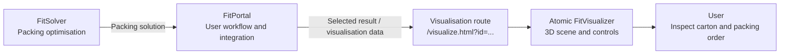

# Atomic FitVisualizer

**Interactive 3D carton-packing visualisation integrated with FitPortal**

Atomic FitVisualizer is the visualisation subsystem of **Project Perfect Fit**, developed by the **Atomic Fit** division. It turns a packing solution into an interactive 3D view so that users can understand **which items go into each carton, where they are positioned, and in what order they should be packed**.

The application is integrated into **FitPortal**, where users can open a packing result and inspect its visualisation. FitVisualizer displays the solution; it **does not run the packing optimisation algorithm**.

**Live FitPortal integration:** [Open the Atomic visualiser](https://atomic-portal2026.vercel.app/visualize.html?id=8dee29f9-dbce-4797-85cf-56173502f370)

> **Note:** The link above points to a specific visualisation record supplied by the team. Its availability depends on the corresponding result remaining accessible in FitPortal. For normal use, open the required result through FitPortal rather than reusing a fixed record ID.

## 1. What the Visualiser Does

The viewer is intended for warehouse and operational users reviewing carton-packing solutions, as well as developers testing the output of the integrated system.

| Capability | User benefit |
| --- | --- |
| **3D carton and item rendering** | See how items fit inside each carton. |
| **Rotate, zoom and pan** | Examine the arrangement from different angles. |
| **Sequential packing animation** | Follow the order in which items are placed. |
| **Playback and timeline controls** | Play, pause or inspect a particular stage of packing. |
| **Multiple-carton navigation** | Review each carton in a solution. |
| **Item inspection panel** | Check item identifiers, dimensions, positions and sequence details. |
| **Consistent item colouring** | Distinguish items while exploring the layout. |
| **Packing-data visualisation** | Display supported packing scenarios supplied to the viewer. |

These capabilities describe the Atomic Visualiser implementation developed by the team. The exact control labels and layout may differ between the standalone development view and the FitPortal-integrated page.

## 2. Access Through FitPortal

The **integrated portal** is the primary entry point for end users.

1. Open [Atomic FitPortal](https://atomic-portal2026.vercel.app/).
2. Open a packing result available in the portal.
3. Follow the portal's visualisation action to display the selected packing result.
4. Explore the rendered carton using the 3D camera controls.
5. Use carton navigation, playback and item inspection controls as applicable to the selected result.

### Visualisation URL

The supplied deployment exposes this route:

```text
https://atomic-portal2026.vercel.app/visualize.html?id=<result-id>
```

For example:

```text
https://atomic-portal2026.vercel.app/visualize.html?id=8dee29f9-dbce-4797-85cf-56173502f370
```

- `/visualize.html` is the **FitPortal-hosted visualisation page**.
- The `id` query parameter identifies the **selected result context** represented by the link.
- The portal-side implementation determines how that identifier is validated and how the corresponding packing data is retrieved or passed to the viewer.

**Important:** Do not treat the example ID as a permanent default, and do not hard-code it into the application. The internal lookup endpoint, authentication requirements and persistence of result IDs must be checked against the deployed FitPortal implementation.

## 3. Position Within Project Perfect Fit



| Subsystem | Responsibility |
| --- | --- |
| **FitSolver** | Determines how items are assigned to cartons and positioned within them. |
| **FitPortal** | Provides the user-facing workflow and connects packing results to the visualiser. |
| **Atomic FitVisualizer** | Renders carton layouts and provides interactive inspection and packing-sequence playback. |

The integrated experience separates **optimisation**, **portal workflow**, and **visualisation** so that each subsystem can evolve independently.

### Integration Boundary

The visualiser expects the packing solution to be made available in a **supported data format**. It uses that information to render the result, not to calculate a new arrangement.

The implementation must agree with FitPortal on:

- **Result selection:** Which solution is opened by the portal link.
- **Cartons and items:** Their identifiers, dimensions, and item-to-carton assignments.
- **3D placement:** Position coordinates, orientation and measurement units.
- **Packing order:** The sequence used for animation.
- **Missing or invalid data:** What the user sees if the result cannot be loaded or rendered.

The precise portal API, transfer mechanism and JSON field names are **implementation-specific**; this document does not invent them. Refer to the deployed portal integration and the visualiser's data-mapping code for the authoritative contract.

## 4. Technology Stack

The standalone Atomic Visualiser implementation uses:

| Technology | Purpose |
| --- | --- |
| **Next.js 16 (App Router)** | Application framework for development. |
| **React 19 + TypeScript** | Component-based, typed user interface. |
| **Three.js** | 3D carton and item rendering. |
| **React Three Fiber** (`@react-three/fiber`) | Rendering Three.js scenes in React. |
| **Drei** (`@react-three/drei`) | Scene helpers and camera interaction. |
| **Tailwind CSS 4** | Interface styling. |
| **ESLint 9** | Static code-quality checks. |

The 3D viewer relies on browser-side **WebGL**. WebGL-dependent components should execute on the client rather than during server-side rendering.

> The production `/visualize.html` route is hosted under **FitPortal**. Do not assume that its deployment layout or URL is identical to the standalone Next.js development server.

## 5. Run the Visualiser Locally

### Requirements

- Node.js compatible with the repository's Next.js version (**Node.js 20.9+** for Next.js 16).
- npm.
- A modern browser with WebGL enabled.
- A local checkout of the Atomic FitVisualizer source repository.

### Installation and Development

From the root of the **visualiser** repository:

```bash
npm install
npm run dev
```

Open the local address reported by the terminal (normally **http://localhost:3000**).

### Production Build

```bash
npm run build
npm run start
```

These commands follow the standard Next.js script names. Confirm the available scripts in this repository's `package.json` before running them. Local development does not, by itself, reproduce FitPortal's result lookup or deployment configuration.

## 6. Data Used for Rendering

The viewer requires enough packing data to construct the carton and position its contents correctly.

| Information | Used for |
| --- | --- |
| Carton identifiers and dimensions | Defining the carton boundaries and selecting a carton. |
| Item identifiers | Matching displayed boxes to item details. |
| Item width, height and depth | Drawing accurately sized 3D boxes. |
| Item coordinates (`x`, `y`, `z`) | Positioning each box within the carton. |
| Rotation or orientation (where supported) | Displaying the intended placement. |
| Packing sequence/order | Controlling the drop-in animation. |
| Multiple carton records | Displaying the full packing solution. |

**Coordinate consistency is essential.** The solver, portal and viewer must use an agreed origin, axis convention and measurement units. Incorrect mappings may place boxes outside carton boundaries or cause unexpected rotations.

The table describes the **data concepts**, not literal JSON property names. The actual schema is defined by the project implementation and integration agreement.

## 7. Using the 3D Viewer

**Explore a carton:** Drag to rotate the view, scroll or pinch to zoom, and use the supported pan gesture to inspect occluded items.

**Inspect an item:** Use the application's item inspection controls to see identifying and placement information.

**Review a packing sequence:** Start or pause playback and use the available timeline/scrubber to inspect how the solution is assembled.

**View other cartons:** Use the carton-selection controls when the selected result contains more than one packed carton.

> Control behaviour can vary by input device. When testing the portal integration, verify both mouse and touch interactions where supported.

## 8. Integration and Release Checks

Before marking a FitPortal/Visualizer integration change as complete, verify:

- [ ] FitPortal opens the visualisation page for a **selected** packing result.
- [ ] The intended result is rendered, rather than a hard-coded sample.
- [ ] All cartons and items appear with the correct dimensions and positions.
- [ ] The item inspection panel displays data matching the selected solution.
- [ ] The packing animation follows the expected sequence.
- [ ] Playback, camera controls and carton navigation work as intended.
- [ ] Missing, invalid or unavailable result IDs are handled appropriately.
- [ ] The integrated page works on the supported desktop and mobile browsers.

These are **acceptance checks**, not claims that every test has been automated.

## 9. Troubleshooting

| Problem | What to check |
| --- | --- |
| The portal's visualisation page is empty | Confirm that the result ID is valid and that the selected packing data is accessible. |
| Viewer opens with the wrong result | Check result-ID handling and how FitPortal supplies or retrieves the selected solution. |
| Boxes appear misplaced or outside the carton | Check axis mapping, units, positions, dimensions and rotations. |
| Cartons or items are missing | Check the data mapping and any missing required fields. |
| Animation occurs in the wrong order | Confirm the sequence values and sort order used by playback. |
| 3D canvas is blank | Check browser WebGL support and the developer console. |
| Local app runs but portal integration fails | Check the portal handoff and deployed configuration separately from the standalone viewer. |

## 10. Project and Team

**Project:** Perfect Fit  
**Division:** Atomic Fit  
**Subsystem:** FitVisualizer  
**Related subsystems:** FitSolver and FitPortal  
**University unit:** COMP4050, Macquarie University  
**Industry client:** Thomax

The Atomic Visualiser team worked with the Atomic FitPortal and FitSolver teams to connect packing-solution output to a user-facing, interactive 3D representation.

### Development Notes

Changes to the packing-data contract should be coordinated across teams. When modifying the visualiser, verify the local application **and** the FitPortal-integrated experience, then update this README if the user workflow or setup instructions change.
